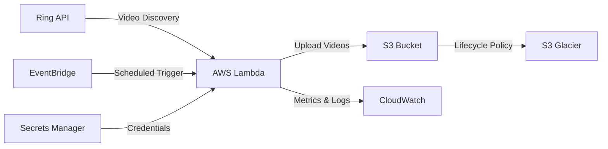
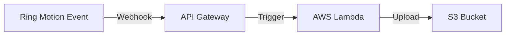

# Design Document: Ring Video AWS Storage

## Overview

This document describes the design for an automated Ring doorbell video storage system that downloads videos from Ring devices and archives them in Amazon S3 with lifecycle management for long-term retention.

The system uses a serverless architecture built on AWS Lambda, triggered periodically by Amazon EventBridge. The Lambda function authenticates with the Ring API, discovers new videos, downloads them, and uploads them to S3 with organized folder structures. S3 lifecycle policies automatically transition older videos to S3 Glacier for cost-efficient archival storage.

### Key Design Goals

1. **Automation**: Fully automated video backup with no manual intervention
2. **Cost Efficiency**: Leverage S3 lifecycle policies to minimize storage costs
3. **Reliability**: Robust error handling with retry logic and comprehensive logging
4. **Organization**: Structured storage format for easy video retrieval
5. **Scalability**: Handle multiple devices and high video volumes

## Architecture

### High-Level Architecture



### Component Flow

1. **EventBridge** triggers Lambda function every 15 minutes (configurable)
2. **Lambda** retrieves Ring credentials from **Secrets Manager**
3. **Lambda** authenticates with **Ring API**
4. **Lambda** queries Ring API for new videos since last check
5. **Lambda** downloads video content from Ring
6. **Lambda** uploads videos to **S3** with metadata tags
7. **Lambda** logs metrics to **CloudWatch**
8. **S3** applies lifecycle policy to transition old videos to **Glacier**

### Optional Webhook Path



## Components and Interfaces

### 1. Ring API Client

**Purpose**: Manages authentication and communication with Ring API

**Key Methods**:
- `authenticate()`: Authenticates using stored credentials, returns session token
- `getNewVideos(since: timestamp)`: Returns list of videos recorded since given timestamp
- `getVideoUrl(videoId: string)`: Returns download URL for specific video
- `downloadVideo(url: string)`: Downloads video content as binary stream

**Error Handling**:
- Retry authentication failures with exponential backoff (2s, 4s, 8s)
- Maximum 3 retry attempts before failing
- Log authentication errors with context

**Dependencies**:
- Ring client library (ring-client-api for Node.js or python-ring-doorbell for Python)
- AWS Secrets Manager for credential retrieval

### 2. Video Processor

**Purpose**: Orchestrates video discovery, download, and upload workflow

**Key Methods**:
- `processNewVideos()`: Main entry point triggered by EventBridge
- `getLastCheckTimestamp()`: Retrieves last successful check time from state store
- `updateLastCheckTimestamp(timestamp)`: Updates state with new checkpoint
- `downloadAndUpload(video)`: Downloads video from Ring and uploads to S3

**Processing Logic**:
```
1. Retrieve last check timestamp
2. Query Ring API for new videos
3. For each video:
   a. Download video content
   b. Generate S3 key with structured path
   c. Upload to S3 with metadata tags
   d. Handle errors without blocking other videos
4. Update last check timestamp
5. Log summary statistics
```

**Concurrency**:
- Process multiple videos concurrently (limit: 5 simultaneous downloads)
- Use Promise.all() or asyncio.gather() for parallel processing
- Fail gracefully if individual videos fail

### 3. S3 Storage Manager

**Purpose**: Handles S3 upload operations with retry logic

**Key Methods**:
- `uploadVideo(content: Buffer, key: string, metadata: object)`: Uploads video to S3
- `generateKey(video)`: Creates structured S3 key path
- `addMetadataTags(video)`: Extracts and formats metadata tags

**S3 Key Structure**:
```
{bucket}/YYYY/MM/DD/{device-name}-HH-MM-SS.mp4

Example:
my-ring-videos/2026/09/22/front-door-15-09-03.mp4
```

**Metadata Tags**:
- `device_name`: Name of Ring device
- `device_id`: Unique device identifier
- `timestamp`: ISO 8601 video recording timestamp
- `event_type`: Type of event (motion, doorbell, etc.)
- `duration`: Video duration in seconds

**Retry Logic**:
- Retry S3 uploads up to 3 times
- Exponential backoff: 2s, 4s, 8s
- Log failures with video ID and error details

**Lifecycle Policy Configuration**:
```json
{
  "Rules": [
    {
      "Id": "TransitionToGlacier",
      "Status": "Enabled",
      "Transitions": [
        {
          "Days": 90,
          "StorageClass": "GLACIER"
        }
      ]
    },
    {
      "Id": "DeleteOldVideos",
      "Status": "Enabled",
      "Expiration": {
        "Days": 2555
      }
    }
  ]
}
```

### 4. State Manager

**Purpose**: Tracks processing state to avoid duplicate video processing

**Key Methods**:
- `getLastCheckTimestamp()`: Returns last successful check timestamp
- `setLastCheckTimestamp(timestamp)`: Updates checkpoint timestamp
- `markVideoProcessed(videoId)`: Records processed video ID (optional deduplication)

**Storage Options**:
- **DynamoDB**: Single-item table with timestamp attribute
- **S3 Object**: JSON file in S3 bucket (simpler, lower cost)
- **Parameter Store**: SSM parameter (lowest cost for small state)

**Recommended Approach**: S3 object for simplicity
```json
{
  "lastCheckTimestamp": "2026-09-22T15:30:00Z",
  "lastSuccessfulRun": "2026-09-22T15:30:15Z"
}
```

### 5. Monitoring and Logging

**Purpose**: Provides visibility into system health and processing metrics

**CloudWatch Metrics**:
- `VideosDiscovered`: Count of new videos found
- `VideosDownloaded`: Count of successfully downloaded videos
- `VideosUploaded`: Count of successfully uploaded videos
- `DownloadFailures`: Count of failed downloads
- `UploadFailures`: Count of failed uploads
- `ProcessingDuration`: Lambda execution time in milliseconds

**Logs**:
- Authentication success/failure
- Video discovery results (count, device names)
- Download progress and errors
- Upload progress and errors
- Summary statistics per execution

**Log Format**:
```json
{
  "timestamp": "2026-09-22T15:30:00Z",
  "level": "INFO",
  "message": "Video uploaded successfully",
  "videoId": "abc123",
  "deviceName": "front-door",
  "s3Key": "2026/09/22/front-door-15-30-00.mp4",
  "duration": 1200
}
```

## Data Models

### Video Record

Represents a Ring video recording with metadata.

```typescript
interface VideoRecord {
  id: string;                    // Unique video identifier
  deviceId: string;              // Ring device ID
  deviceName: string;            // Human-readable device name
  timestamp: Date;               // Recording timestamp
  eventType: string;             // "motion" | "doorbell" | "manual"
  duration: number;              // Duration in seconds
  downloadUrl: string;           // Ring API download URL
  thumbnailUrl?: string;         // Optional thumbnail URL
}
```

### Processing State

Tracks the last successful processing checkpoint.

```typescript
interface ProcessingState {
  lastCheckTimestamp: string;    // ISO 8601 timestamp
  lastSuccessfulRun: string;     // ISO 8601 timestamp
  processedCount?: number;       // Optional: total videos processed
}
```

### Configuration

System configuration parameters.

```typescript
interface Configuration {
  ringCredentials: {
    email: string;
    password: string;
    twoFactorToken?: string;
  };
  s3: {
    bucketName: string;
    region: string;
  };
  schedule: {
    intervalMinutes: number;     // Default: 15
  };
  lifecycle: {
    glacierTransitionDays: number;  // Default: 90
    expirationDays: number;         // Default: 2555 (7 years)
  };
  retry: {
    maxAttempts: number;         // Default: 3
    baseDelayMs: number;         // Default: 2000
  };
}
```

## Correctness Properties

*A property is a characteristic or behavior that should hold true across all valid executions of a system—essentially, a formal statement about what the system should do. Properties serve as the bridge between human-readable specifications and machine-verifiable correctness guarantees.*

### Property 1: Authentication at Startup
*For any* execution of the Video_Processor, authentication with the Ring_API SHALL be attempted using credentials retrieved from AWS Secrets Manager before any video operations are performed.
**Validates: Requirements 1.1, 1.4**

### Property 2: Session Persistence After Authentication
*For any* successful authentication, subsequent API calls within the same execution SHALL use the established session without re-authenticating.
**Validates: Requirements 1.2**

### Property 3: Authentication Retry with Exponential Backoff
*For any* authentication failure, the Video_Processor SHALL retry up to 3 times with exponential backoff delays (2s, 4s, 8s), logging each failure.
**Validates: Requirements 1.3**

### Property 4: Query with Correct Timestamp Filter
*For any* scheduled trigger, the Video_Processor SHALL query the Ring_API with a timestamp filter equal to the last successful check timestamp.
**Validates: Requirements 2.1, 2.5**

### Property 5: Download URL Retrieval for All Discovered Videos
*For any* set of discovered videos, the Video_Processor SHALL retrieve download URLs for all videos before proceeding to download.
**Validates: Requirements 2.2**

### Property 6: Video Content Download
*For any* valid video URL, the Video_Processor SHALL successfully download the video content or log a failure after exhausting retries.
**Validates: Requirements 2.3**

### Property 7: Failure Isolation
*For any* video download failure, the Video_Processor SHALL continue processing remaining videos without terminating execution.
**Validates: Requirements 2.4**

### Property 8: Structured S3 Path Format
*For any* uploaded video, the S3 key SHALL match the pattern `{bucket}/YYYY/MM/DD/{device-name}-HH-MM-SS.mp4` where YYYY/MM/DD corresponds to the video timestamp date and HH-MM-SS corresponds to the video timestamp time.
**Validates: Requirements 3.1, 3.2**

### Property 9: Required Metadata Tags
*For any* uploaded video, the S3 object SHALL include metadata tags for device_name, timestamp, and event_type at minimum.
**Validates: Requirements 3.3**

### Property 10: Unique Filename Generation
*For any* video with the same device and timestamp (down to the second), the Video_Processor SHALL generate unique S3 keys to prevent overwrites.
**Validates: Requirements 3.4**

### Property 11: Upload Verification Before State Update
*For any* video upload operation, the Video_Processor SHALL verify upload success (via S3 HeadObject or ETag validation) before updating the last check timestamp.
**Validates: Requirements 3.5**

### Property 12: Error Logging with Complete Context
*For any* error during processing, the Video_Processor SHALL emit a log entry containing timestamp, operation name, error type, and error message.
**Validates: Requirements 6.1**

### Property 13: Retry Exhaustion Handling
*For any* video download that fails after 3 retry attempts, the Video_Processor SHALL log a critical-level error and proceed to the next video without retrying further.
**Validates: Requirements 6.2**

### Property 14: S3 Upload Retry with Exponential Backoff
*For any* S3 upload failure, the Video_Processor SHALL retry up to 3 times with exponential backoff delays (2s, 4s, 8s).
**Validates: Requirements 6.3**

### Property 15: CloudWatch Metrics Emission
*For any* processing execution, the Video_Processor SHALL emit CloudWatch metrics for videos_discovered, videos_downloaded, videos_uploaded, download_failures, upload_failures, and processing_duration_ms.
**Validates: Requirements 6.4**

### Property 16: Summary Statistics Logging
*For any* completed processing execution, the Video_Processor SHALL log summary statistics including total videos processed, successful uploads, failed operations, and total storage bytes uploaded.
**Validates: Requirements 6.5**

### Property 17: Temporary File Cleanup
*For any* execution of the Video_Processor, all temporary files created during video download SHALL be deleted before the Lambda function completes, regardless of success or failure.
**Validates: Requirements 7.4**

### Property 18: Duplicate Video Prevention
*For any* video ID, regardless of trigger source (scheduled poll or webhook), the Video_Processor SHALL process that video at most once, using the video ID as a deduplication key.
**Validates: Requirements 8.4**


## Error Handling

### Error Categories

The system handles four categories of errors:

1. **Authentication Errors**: Ring API authentication failures
2. **API Errors**: Ring API rate limiting, timeouts, or service errors
3. **Download Errors**: Video download failures (network, timeout, corrupted data)
4. **Upload Errors**: S3 upload failures (network, throttling, permission errors)

### Error Handling Strategy

#### Authentication Errors

- Retry with exponential backoff: 2s, 4s, 8s (max 3 attempts)
- Log each failure with error details
- If all retries fail, terminate execution and alert via CloudWatch alarm
- Do not proceed with video operations without valid authentication

#### API Errors

**Rate Limiting (429)**:
- Implement exponential backoff with jitter
- Respect Retry-After header if provided
- Maximum 5 retry attempts
- Log rate limit events for monitoring

**Timeouts**:
- Set request timeout to 30 seconds
- Retry up to 3 times
- Log timeout occurrences

**Service Errors (5xx)**:
- Retry up to 3 times with exponential backoff
- Log service errors for monitoring
- Continue with partial results if some videos succeeded

#### Download Errors

- Retry individual video downloads up to 3 times
- Use exponential backoff: 2s, 4s, 8s
- Log failed downloads with video ID and device name
- Continue processing remaining videos (fail-open approach)
- Track failed downloads in metrics for monitoring

#### Upload Errors

**S3 Throttling (503)**:
- Retry with exponential backoff: 2s, 4s, 8s
- Maximum 3 attempts per video
- Consider reducing concurrent uploads if persistent

**Network Errors**:
- Retry up to 3 times with exponential backoff
- Log network error details
- Continue with remaining videos

**Permission Errors (403)**:
- Do not retry (permanent failure)
- Log error with S3 key and bucket name
- Alert via CloudWatch alarm (indicates configuration issue)

### Error Recovery

**Partial Failure Handling**:
- Process videos independently to isolate failures
- Update last check timestamp only after at least one successful upload
- If all videos fail, do not update timestamp (retry same videos next execution)

**Cleanup on Error**:
- Ensure temporary files are deleted even on error
- Use try-finally blocks or context managers
- Log cleanup operations for debugging

**State Consistency**:
- Use atomic operations for state updates
- Do not mark videos as processed unless upload verified
- Implement idempotency for webhook triggers

### Monitoring and Alerting

**CloudWatch Alarms**:
- Authentication failures > 3 in 15 minutes
- Upload failure rate > 20% over 1 hour
- No successful executions in 2 hours
- Lambda errors or timeouts

**Metrics Dashboard**:
- Success rate trend (last 24 hours)
- Average processing duration
- Videos processed per hour
- Storage growth rate

## Testing Strategy

### Overview

The testing strategy combines unit tests for specific scenarios and property-based tests for universal correctness properties. Both approaches are complementary and necessary for comprehensive coverage.

### Unit Testing

**Focus Areas**:
- Specific edge cases not covered by properties
- Integration points between components
- Error conditions with specific inputs
- Configuration validation

**Example Unit Tests**:

1. **Authentication Edge Cases**
   - Test missing Secrets Manager configuration
   - Test malformed credentials format
   - Test two-factor authentication flow

2. **S3 Key Generation**
   - Test filename uniqueness with millisecond precision
   - Test special characters in device names
   - Test timezone handling for UTC conversion

3. **Retry Logic**
   - Test exponential backoff timing accuracy
   - Test maximum retry limit enforcement
   - Test retry with different error types

4. **State Management**
   - Test state file creation on first run
   - Test concurrent access handling
   - Test state recovery after Lambda timeout

### Property-Based Testing

**Testing Library**: Use fast-check (Node.js) or Hypothesis (Python) for property-based testing

**Configuration**: 
- Minimum 100 iterations per property test
- Seed-based reproducibility for failed tests
- Custom generators for domain objects

**Tag Format**: Each property test must reference its design property:
```
Feature: ring-video-aws-storage, Property 8: Structured S3 Path Format
```

**Property Test Examples**:

1. **Property 8: Structured S3 Path Format**
   - Generate random video records with varied timestamps and device names
   - Generate S3 keys for each video
   - Verify all keys match regex: `^\d{4}/\d{2}/\d{2}/[\w-]+-\d{2}-\d{2}-\d{2}\.mp4$`
   - Verify date components match video timestamp

2. **Property 9: Required Metadata Tags**
   - Generate random video records
   - Create metadata tags for each video
   - Verify all tag objects contain keys: device_name, timestamp, event_type
   - Verify timestamp format is ISO 8601

3. **Property 10: Unique Filename Generation**
   - Generate multiple videos with identical timestamps
   - Generate S3 keys for all videos
   - Verify all keys are unique (use Set comparison)
   - Verify keys differ only in suffix or microsecond component

4. **Property 17: Temporary File Cleanup**
   - Generate random video processing scenarios (success and failure)
   - Execute video processing with mocked downloads
   - Verify temp directory is empty after processing
   - Verify cleanup happens even on exceptions

5. **Property 18: Duplicate Video Prevention**
   - Generate random video IDs and simulate multiple processing attempts
   - Process same video IDs multiple times
   - Verify each video ID is uploaded exactly once to S3
   - Verify state correctly tracks processed video IDs

### Integration Testing

**Test Environment**:
- LocalStack for S3 simulation
- Ring API mocks or test doubles
- Mock Secrets Manager responses

**Integration Test Scenarios**:

1. **End-to-End Happy Path**
   - Authenticate with Ring API (mocked)
   - Discover new videos (mocked response)
   - Download videos (mock HTTP responses)
   - Upload to S3 (LocalStack)
   - Verify S3 objects exist with correct keys and metadata

2. **Partial Failure Recovery**
   - Simulate mix of successful and failed downloads
   - Verify successful videos are uploaded
   - Verify state is updated correctly
   - Verify failed videos are retried on next execution

3. **Webhook and Polling Coexistence**
   - Simulate webhook trigger processing video X
   - Simulate scheduled poll discovering same video X
   - Verify video X is uploaded only once
   - Verify both triggers log correctly

### Test Coverage Goals

- **Unit Test Coverage**: 80% line coverage minimum
- **Property Test Coverage**: All 18 correctness properties implemented
- **Integration Test Coverage**: All major workflows and failure scenarios
- **Critical Paths**: 100% coverage for authentication, upload, and state management

### Testing Implementation

**Property Test Implementation Example (TypeScript with fast-check)**:

```typescript
import fc from 'fast-check';

// Feature: ring-video-aws-storage, Property 8: Structured S3 Path Format
describe('Property 8: Structured S3 Path Format', () => {
  it('should generate S3 keys matching the required pattern', () => {
    fc.assert(
      fc.property(
        fc.record({
          id: fc.uuid(),
          deviceName: fc.stringMatching(/^[a-zA-Z0-9-]+$/),
          timestamp: fc.date({ min: new Date('2020-01-01') }),
          eventType: fc.constantFrom('motion', 'doorbell', 'manual')
        }),
        (video) => {
          const key = generateS3Key(video);
          const pattern = /^\d{4}\/\d{2}\/\d{2}\/[\w-]+-\d{2}-\d{2}-\d{2}\.mp4$/;
          expect(key).toMatch(pattern);
          
          // Verify date components match timestamp
          const [year, month, day] = key.split('/').slice(0, 3);
          expect(year).toBe(video.timestamp.getUTCFullYear().toString());
          expect(month).toBe((video.timestamp.getUTCMonth() + 1).toString().padStart(2, '0'));
          expect(day).toBe(video.timestamp.getUTCDate().toString().padStart(2, '0'));
        }
      ),
      { numRuns: 100 }
    );
  });
});
```

**Property Test Implementation Example (Python with Hypothesis)**:

```python
from hypothesis import given, strategies as st
import re

# Feature: ring-video-aws-storage, Property 18: Duplicate Video Prevention
@given(
    video_ids=st.lists(st.uuids(), min_size=1, max_size=10),
    trigger_counts=st.integers(min_value=1, max_value=5)
)
def test_duplicate_prevention(video_ids, trigger_counts):
    """Property 18: Each video should be processed at most once"""
    processor = VideoProcessor()
    uploaded_videos = []
    
    # Simulate multiple triggers for same videos
    for _ in range(trigger_counts):
        for video_id in video_ids:
            result = processor.process_video(video_id)
            if result.uploaded:
                uploaded_videos.append(video_id)
    
    # Verify each video uploaded exactly once
    unique_uploads = set(uploaded_videos)
    assert len(unique_uploads) == len(set(video_ids))
    assert all(uploaded_videos.count(vid) == 1 for vid in unique_uploads)
```

### Continuous Testing

- Run unit tests on every commit
- Run property tests on every pull request
- Run integration tests before deployment
- Monitor property test failures in CI/CD pipeline
- Track test execution time and optimize slow tests
