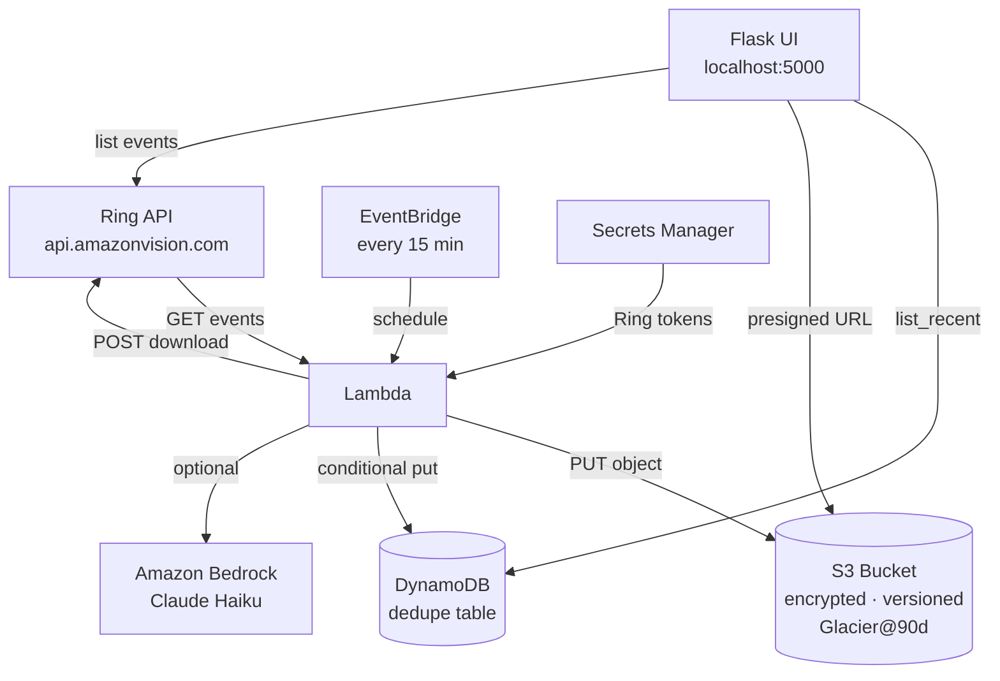

# RingArchive

**Automatically back up your Ring doorbell clips to your own private AWS storage.**

RingArchive connects to the official Ring API (`api.amazonvision.com`), pulls new doorbell event clips, stores each one in a private encrypted S3 bucket, and tracks them in DynamoDB — so you own your footage forever, not just for 60 days.

---

## Features

- **Official Ring API** — uses `api.amazonvision.com` (`GET /v1/history/devices/{id}/events`, `POST /v1/devices/{id}/media/video/download`), not the unofficial community library
- **Ring Developer Playground** — works with the simulator for development and testing
- **Private S3 storage** — AES-256 encrypted, versioned, public access blocked, auto-transitions to Glacier after 90 days
- **DynamoDB dedupe** — conditional writes ensure each clip is archived exactly once, even across concurrent Lambda runs
- **AWS Lambda + EventBridge** — polls Ring every 15 minutes automatically via AWS SAM
- **Dashboard UI** — Flask web app with unified event+clip table, inline video player, export to disk / Dropbox / Google Drive, bulk select, device and event-type filters
- **AWS Secrets Manager** — Ring credentials stored securely; tokens auto-refreshed and persisted
- **Optional Bedrock summaries** — Claude Haiku writes a one-line description per clip (set `BEDROCK_SUMMARY_ENABLED=true`)
- **MIT licensed**

---

## Architecture



---

## Prerequisites

- Python 3.12+
- AWS account with permissions for S3, DynamoDB, Lambda, EventBridge, Secrets Manager (and optionally Bedrock)
- AWS SAM CLI (`pip install aws-sam-cli`) for deploy
- Ring Developer account at [developer.amazon.com/api/ring](https://developer.amazon.com/api/ring)

---

## Setup

### 1. Ring credentials

Log in to the [Ring Developer Portal](https://developer.amazon.com/api/ring) and copy your **Playground access token**.

### 2. Configure environment

```bash
cp .env.example .env
# Edit .env — set RING_ACCESS_TOKEN, ARCHIVE_BUCKET, DYNAMO_TABLE, AWS_REGION
```

### 3. AWS credentials

```bash
aws configure   # region: eu-west-2
```

### 4. Install dependencies

```bash
pip install -r requirements.txt
pip install -e .
```

### 5. Create AWS resources (one-time)

```bash
aws s3api create-bucket --bucket <ARCHIVE_BUCKET> --region eu-west-2 \
    --create-bucket-configuration LocationConstraint=eu-west-2
aws s3api put-public-access-block --bucket <ARCHIVE_BUCKET> \
    --public-access-block-configuration BlockPublicAcls=true,IgnorePublicAcls=true,BlockPublicPolicy=true,RestrictPublicBuckets=true
aws dynamodb create-table --table-name RingArchiveEvents \
    --attribute-definitions AttributeName=event_id,AttributeType=S \
    --key-schema AttributeName=event_id,KeyType=HASH \
    --billing-mode PAY_PER_REQUEST --region eu-west-2
```

---

## Usage

### Run one archive pass (demo / local)

```bash
python -m ringarchive.run_once
```

Output: `archived=N  skipped=M  errors=0`

- **archived** — new clips saved to S3 + recorded in DynamoDB
- **skipped** — already archived (dedupe working)
- **errors** — failed downloads (416 = Playground doesn't serve MP4 bytes; expected on simulator)

### List archived clips

```bash
python -m ringarchive.list_clips
```

Prints event IDs, timestamps, summaries, and 1-hour presigned S3 URLs.

### Start the dashboard UI

```bash
python -m ringarchive.ui
# Open http://localhost:5000
```

Features: unified event+clip table · click any row to play video · export to disk / Dropbox / Drive · bulk select · filter by device and event type.

---

## Deploy to AWS

```bash
sam build
sam deploy --guided
```

Follow the prompts. Provide your Ring credentials when asked — they are stored in Secrets Manager, never in code or environment variables on Lambda.

---

## Tests

```bash
pytest
```

6 tests covering: new-event detection, mark-and-detect, idempotent marking, independent events, list_recent, and summary persistence.

---

## How Kiro was used

This project was built during the hackathon window (23 Oct 2026) using **Kiro** as the primary development assistant.

- **Specs** — full requirements, design, decisions and tasks are in `.kiro/specs/ring-video-aws-storage/`
- **Ring App Store Knowledge MCP** — the `ring-appstore-knowledge-mcp-server` MCP (`https://knowledge.appstore-mcp.ring.amazon.dev/mcp`) was connected to verify official API endpoint paths and auth patterns
- **Code generation** — Kiro wrote all source files, the SAM template, tests and documentation in a single session
- **Autonomous agents** — Kiro Crew Conductor managed the build sequence: Ring client → archiver → dedupe → SAM → README → UI → export features

---

## License

MIT — see [LICENSE](LICENSE). Copyright (c) 2026 Natfla Ltd.
