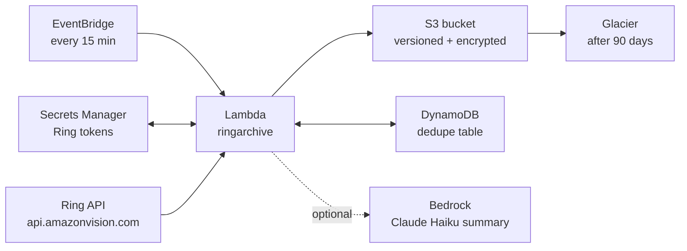

# RingArchive

A personal backup service that copies Ring doorbell event clips into your own private AWS S3 bucket.  
Built for the Amazon **"Build, Ship, Shape"** hackathon — Ring track + AWS Builder mini challenge.

---

## What it does

Every 15 minutes an AWS Lambda polls the official **Ring Partner API** (`api.amazonvision.com`) for new motion/doorbell events on every linked device.  
New clips are downloaded as MP4 and stored at:

```
s3://<bucket>/<device_id>/<YYYY>/<MM>/<DD>/<event_id>.mp4
```

DynamoDB records every archived event so the same clip is never downloaded twice.  
After 90 days, clips are automatically moved to S3 Glacier.  
Optionally, Amazon Bedrock (Claude Haiku) writes a one-line summary per clip stored in DynamoDB.

---

## Architecture



---

## Prerequisites

| Requirement | Notes |
|---|---|
| Ring Developer account | [developer.amazon.com/ring](https://developer.amazon.com/ring/console/apps) — create an app, get `client_id`, `client_secret` |
| Ring Simulator or real device | Simulator available in the Ring Dev Portal staging environment |
| AWS account | IAM user / role with S3, DynamoDB, Lambda, SAM, SecretsManager permissions |
| Python 3.12 | `python --version` |
| AWS SAM CLI | `sam --version` |

---

## Setup

### 1 — Get Ring credentials

1. Log in to the Ring Developer Portal and create an app.
2. Note your **Client ID**, **Client Secret**, and **HMAC Key**.
3. In the staging environment, link the simulator account.  
   This gives you an **access_token** and **refresh_token** (the lambda refreshes them automatically).

### 2 — Configure environment

```bash
cp .env.example .env
# Fill in RING_CLIENT_ID, RING_CLIENT_SECRET, RING_ACCESS_TOKEN, RING_REFRESH_TOKEN
# Fill in ARCHIVE_BUCKET, DYNAMO_TABLE, AWS_REGION
```

### 3 — Install Python dependencies (local dev)

```bash
python -m pip install -r requirements-dev.txt
pip install -e .
```

### 4 — Run tests

```bash
pytest tests/ -v
```

### 5 — Run once locally (against simulator)

```bash
python -m ringarchive.run_once
```

### 6 — List archived clips

```bash
python -m ringarchive.list_clips
```

### 7 — Deploy to AWS

```bash
sam build
sam deploy --guided
# Follow prompts; supply Ring credentials as SecureString parameters
```

---

## How Kiro was used

Kiro was used throughout this project to:

- Research the official Ring Partner API documentation and identify the correct endpoints, auth flow, and required headers (`User-Agent`, `Hardware_Id`).
- Discover that the originally-planned unofficial `ring-doorbell` library is prohibited by the hackathon rules, and pivot to the official `api.amazonvision.com` REST API.
- Generate all Python modules (`ring_client.py`, `archiver.py`, `state.py`, `handler.py`) and the SAM `template.yaml`.
- Write unit tests using `moto` for the DynamoDB dedupe logic.
- Write this README, the demo script, and the feedback notes.

---

## License

MIT — see [LICENSE](LICENSE).
