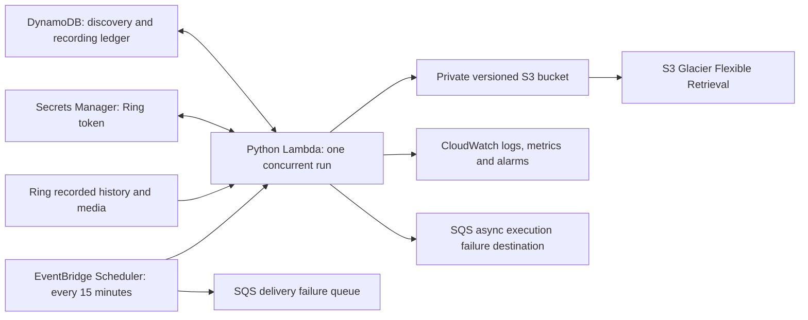
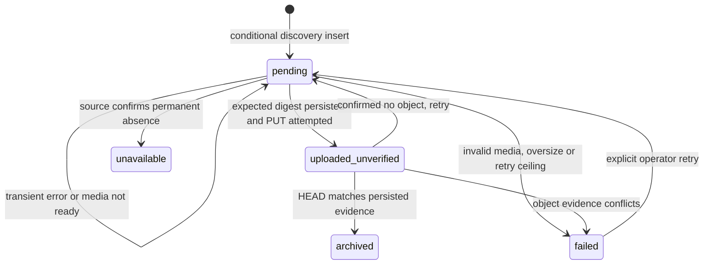

# Design: Ring Video AWS Storage

Revision: 2026-09-22. Proposed implementation; no application or cloud resources created.

## Architecture and boundaries

One account, a configured device allowlist, one Python 3.12 Lambda, scheduled polling and sequential video transfer. Use AWS SAM/CloudFormation for deployment. Production Python packages are `ring-doorbell`, `boto3` and the streaming HTTP dependency; pin tested versions separately from pytest, Hypothesis and AWS test doubles. The final lock and Linux package build are implementation work.



Glacier is an S3 storage class in the same bucket, not a second bucket or upload destination. API Gateway and a public application are not needed for the polling MVP. The official Partner API is a later adapter with separate prerequisites; see [decisions.md](decisions.md).

## Configuration

| Setting | Proposed default | Validation/meaning |
| --- | --- | --- |
| AWS region | Required deployment input | No region inferred from operator timezone |
| Account namespace | Stable generated UUID | Reuse after redeployment; never use email |
| Device IDs | Required allowlist | Reject unknown or unsupported devices |
| Schedule | 15 minutes | Integer minutes, minimum 15 for MVP |
| Overlap / initial history | 24 hours / 24 hours | Backfill is an explicit separate range |
| Lambda timeout / memory / temporary disk | 600 seconds / 1,024 MiB / 2,048 MiB | Benchmark in staging |
| Stop-new-work reserve | 60 seconds | Every operation also bounded by remaining time |
| Transfer concurrency | 1 | Single account token writer |
| Page size / page budget | 100 / 100 per run | Verify source honours page size |
| Recording budget | 50 attempted identities per run | Fair rotation across devices |
| Maximum recording size | 256 MiB | Oversize becomes a visible failed item |
| HTTP connect / read-idle / total | 10 / 30 / 120 seconds | Cap total by Lambda deadline |
| Application attempts | 3 total | Initial call plus at most two retries |
| Transition / expiration | 90 / 2,555 days | Expiration may be disabled explicitly |
| Noncurrent expiration | 1 day | Protect against indefinite version accumulation |
| Log retention | 30 days | No media, tokens or signed URLs in logs |

These are limits, not promised throughput. An increasing backlog or discovery lag is a capacity signal; raise budgets only after measurement. If one Lambda cannot keep up, split discovery and transfers with an SQS worker design in a later revision.

## Components and interfaces

| Module | Responsibility |
| --- | --- |
| `config.py`, `models.py` | Validated configuration, aware UTC timestamps, typed records |
| `auth.py` | Secret loading, stable hardware ID, serialized token refresh/persistence |
| `ring_adapter.py` | Device discovery, history pages, normalized records, fresh media URL |
| `state.py` | Conditional inserts, scan continuations, retry eligibility, archive evidence |
| `storage.py` | Stable keys, conditional S3 puts, checksum verification, reconciliation |
| `processor.py` | Fair bounded discovery and transfer orchestration |
| `observability.py` | Redacted logs, summaries and CloudWatch metrics |
| `handler.py` | Lambda entry point, deadlines, dependency construction and cleanup |
| `cli.py` | Setup, device listing, status, bounded backfill, retry and restore guidance |

Use Python snake_case APIs and dataclasses. The adapter contract is:
`list_devices()`, `history_page(device_id, cursor, page_size)`, and
`resolve_media(recording)`. A normalized history page returns records, next cursor and a completeness indicator. It must not pretend the community library accepts a `since` timestamp. Filter timestamps locally; translate the library's `older_than` event-ID cursor inside the adapter.

The recorded event model contains account namespace, device ID, event ID, original device name, aware UTC recording time, event type and optional duration. Signed URLs are transient, resolved immediately before transfer and excluded from persisted models.

## Authentication and token lifecycle

1. A local setup command uses secure password/MFA prompts and completes the client's login flow. Save only its token document, schema version and stable hardware ID in Secrets Manager using the operator's AWS identity.
2. Lambda reads that secret on each invocation and constructs one client session for the run. It never receives a password in environment variables or infrastructure parameters.
3. The token-updater callback persists every actual replacement token before further Ring work. Do not defer persistence until the end of a run. A save failure ends Ring processing and emits an authentication failure; retry the AWS write within the bounded retry policy without logging token content.
4. Share one session; serialize refresh. Configure the underlying SDK retry budgets so hidden retries do not multiply unboundedly.
5. Revoked credentials or required MFA produce reconnect-required health. Transient auth transport failures may retry; invalid credentials do not.
6. Pause scheduling, wait for active and queued invocations to drain, and prevent manual invocations before replacing credentials through setup. Keep one deployment as the writer for the account.
7. Secrets Manager is not a per-event state store. Write changed tokens only. Alert on repeated refresh churn; the 15-minute minimum schedule avoids making short polling itself a secret-version churn source.

External token rotation and secret persistence cannot be a distributed transaction. If the process dies in that gap and the previous token no longer works, reconnection is required and must be visible.

## Durable discovery and ledger

Use one encrypted, on-demand DynamoDB table with point-in-time recovery. Retain it on stack deletion/replacement. Do not expire unfinished work.

- Partition key: `ACCOUNT#{account_namespace}`.
- Recording sort key: `EVENT#{device_id}#{event_id}`, with bounded, escaped IDs.
- Per-device discovery keys: `SCAN#{device_id}#LIVE` and `SCAN#{device_id}#BACKFILL`.
- Account status key: `STATUS`.
- Sparse work index: `work_partition = ACCOUNT#{namespace}#PENDING`, numeric `next_attempt_at` as sort key. Remove index attributes on terminal outcomes.
- Due-work index results are hints: strongly re-read each primary record before work. Stale index entries cannot cause an archived record to be processed again.

A ledger item stores identity, normalized event metadata, frozen object key, status, attempt count, next retry time, safe failure code, first-seen time and archive evidence. Evidence includes expected byte count and SHA-256, S3 version ID and verification timestamp. No signed URLs or tokens belong here.

States:



`uploaded_unverified` is also indexed for due work. It covers an uncertain PUT result; it does not assert that an object exists. Permanent states retain identity tombstones to prevent accidental re-creation after S3 expiration. No automatic TTL is set for completed identities in the MVP; document ledger growth and explicit cleanup. Restoring or deleting ledger state requires a reconciliation procedure, not a blank reset.

### Discovery algorithm

1. Rotate the starting device each invocation. Allocate budget to both discovery and pending transfer, rather than draining one indefinitely.
2. For a new live scan, capture `high = now_utc` and `low = completed_checkpoint - overlap`; first scan uses `now - initial_history`. Freeze both in a scan record.
3. Start from newest history and follow actual provider cursors. Persist each qualifying event with a conditional insert. A duplicate must not replace its frozen key, status or evidence.
4. Only after every item in a page is durably represented may the continuation advance. If the process dies earlier, replay that page.
5. Stop once the sorted provider history crosses the lower bound or genuinely ends. Validate order, detect repeated cursors and bound page calls. If the provider cannot prove completeness, mark the scan incomplete and alert.
6. Advance the completed checkpoint to the frozen high bound only after enumeration is complete. This is safe even when downloads remain pending because those identities are already durable.
7. If the run budget ends, save the current scan and continue next invocation. A rejected/expired cursor restarts the same bounded interval from its newest page; idempotent inserts make replay safe.
8. Backfill has independent bounds/cursor and cannot move the live checkpoint. Share time fairly with live discovery and pending work.

The overlap handles delayed visibility within its configured window. Delays longer than the overlap, source expiration during an outage, and undocumented API truncation cannot be covered by an absolute no-loss promise. Report coverage/lag and use explicit reconciliation backfills where footage is still available.

## Download, identity and upload protocol

Freeze an object key on first discovery:

```text
s3://<bucket>/videos/2026/09/22/front-door-15-09-03-<64-hex-identity-hash>.mp4
```

The suffix is SHA-256 of a canonical JSON array containing the complete account/device/event identity, not a timestamp or random retry suffix. Camera slug is lowercase ASCII, trimmed and capped at 64 characters, with `camera` as fallback. Store the chosen key in the ledger so renaming a camera cannot move an existing identity. A hash collision or mismatching identity is a hard conflict, never permission to overwrite. Validate full key length.

For each due identity:

1. Strongly read status. Skip archived/unavailable items and failed items unless explicitly requeued.
2. If prior expected evidence exists, HEAD the frozen key first. Match identity, size and S3 SHA-256 to reconcile an upload that completed before a crash. Archived-class objects can be checked without restoring their media.
3. Resolve a fresh URL only when transfer is needed. Require HTTPS, bound redirects, and never forward Ring authorization headers to a redirected media host. Do not accept download URLs from invocation payloads.
4. Stream to an app-owned temporary directory in bounded chunks. Enforce actual byte limits even when Content-Length is missing or false. Reject empty, truncated and non-media responses; inspect the MP4 container signature in addition to MIME type. This is a sanity check, not proof that every frame decodes.
5. Calculate SHA-256 while streaming. Persist the expected size/digest and `uploaded_unverified` state BEFORE putting the object. On replay, retain prior evidence until a HEAD result proves whether its upload exists.
6. Use a single bounded `PutObject` with file body, explicit ContentLength, `IfNoneMatch="*"`, `ChecksumSHA256`, content type and user metadata. The 256 MiB cap avoids a multipart implementation in the MVP.
7. HEAD with checksum retrieval enabled. Match size, stored identity and SHA-256; record the version ID and atomically mark archived. An ETag alone is not checksum verification.
8. For 412, reconcile; for 409 or transient error, retry/reconcile within budget. Treat only a confirmed not-found as absence. Access denied, network failures or conflicting content leave work unresolved or failed.
9. Clean up in finally. A later invocation sweeps only abandoned paths beneath the app-owned temp root after a forced kill.

S3 and DynamoDB do not commit atomically. This protocol provides repeat-safe archival with reconciliation; it does not promise exactly one network request or exactly-once execution. Retained ledger tombstones prevent automatic recreation after an intentional deletion or lifecycle expiration. Repair of a missing object for an already archived identity must be an explicit operator action.

Metadata is S3 user metadata, not object tags. Percent-encode non-ASCII text, cap the combined metadata budget below S3's limit, and keep full normalized metadata in DynamoDB. Avoid exposing device names as metric dimensions.

## Retry classification and deadlines

One operation gets three total application attempts: immediate, then jitter in [0, 2] seconds, then [0, 4] seconds. Never sleep after the last attempt. Bound SDK attempts explicitly; tests must count actual underlying calls. A 429 Retry-After longer than remaining budget schedules later work instead of sleeping past the deadline.

| Condition | Outcome |
| --- | --- |
| Transient network/5xx/throttle | Bounded retry, then persist deferred work |
| Media still processing | Later retry with fresh URL; no archived state |
| Expired media URL | Resolve once again within the operation budget |
| Revoked token/MFA required | Stop Ring work, reconnect-required alarm |
| Access denied | Visible configuration/permission failure, no retry loop |
| Source explicitly expired/deleted | Unavailable with reason, not success |
| Ambiguous 404 or missing media | Defer until source meaning is established |
| Invalid/truncated/oversize video | Failed with reason, retain identity |
| Unknown S3 outcome | Reconcile before another conditional upload |

After operation exhaustion, schedule exponential deferred retries starting at 15 minutes and capped at six hours. After 24 failed processing cycles or seven days pending, pause the identity as failed and alert; explicit operator retry remains available while the source exists. One event failure does not abort other events, but shared auth/state-store failures do stop unsafe progress.

Check remaining Lambda time before every request and retry. Keep 60 seconds for state/metrics/cleanup; reduce individual request deadlines accordingly. SDK calls executed from async code must not block the event loop beyond those bounds.

## AWS security and operations

- Private bucket, Block Public Access enabled, BucketOwnerEnforced ownership, versioning, default SSE-S3 and TLS-only bucket policy. SSE-KMS is an optional configuration with explicit key permissions.
- Processor role: GetObject/PutObject for `videos/*`, exact table/index read/write/query operations, GetSecretValue/PutSecretValue for one secret, its log group, and namespace-scoped metrics. Include only the bucket listing needed for reliable absence checks, constrained to the video prefix.
- No runtime S3 deletion, bucket-policy changes, public ACL writes or Ring destructive operations.
- Scheduler role: invoke only the backup Lambda and send only to its delivery DLQ. Lambda execution role: send only to its configured async failure destination.
- Scheduler delivery retry age/count and Lambda async retry age/count are configured separately (proposed 15-minute age, two retries). Use two SQS queues and queue alarms; no worker queue is required in the MVP.
- CloudFormation retains archive/table/secret on deletion and replacement. The deployment artifact bucket is separate.
- No VPC by default: the function needs outbound Ring access. If a private VPC is introduced, design its internet egress and cost explicitly.
- Build/install dependencies for the chosen Linux Lambda architecture; do not zip Windows native packages.

CloudWatch emits aggregate metrics with low-cardinality dimensions. Empty successful scans publish a heartbeat; auth/discovery failure must not do so. A per-event failure can coexist with a service heartbeat, so pending-age and failure counters are independently alarmed. Retain latest complete discovery and last verified upload separately in the status row.

Alarm actions use an operator-configured notification destination. Staging must prove delivery; creating an alarm alone does not prove someone will receive it.

## Lifecycle, retrieval and cost

Use separate lifecycle rules for current transition/expiration, noncurrent expiration, expired-delete-marker cleanup, and aborting incomplete multipart uploads. Filter all video rules to `videos/`. Do not apply a transition to state or deployment artifacts.

Default current transition: 90 days to GLACIER; current expiration: 2,555 days; noncurrent expiration: one day; multipart abort: one day. Keep AWS's default exclusion for transition of objects smaller than 128 KB. Glacier Flexible Retrieval has a 90-day minimum storage charge; validate expiration >= transition + 90 when expiration is enabled.

Versioned expiration first creates a delete marker. Permanent deletion of the noncurrent data is later and lifecycle evaluation is asynchronous. Never describe this as guaranteed deletion at exactly seven years. Changing a policy can make existing objects immediately eligible; show that in the deployment change review.

To retrieve archived footage, request a restore, wait for its completion, then download the temporary restored copy. Document expedited/standard/bulk options and their current cost/availability at implementation time. Routine lookup should use the ledger, not repeated whole-bucket scans.

Estimate capacity from measured data:
`daily bytes = device count × average clips per device/day × mean clip bytes`.
Then model Standard bytes for the first 90 days, archival bytes thereafter, uploads/HEAD requests, transitions, secret storage, DynamoDB, Lambda, logs and restores. Do not reuse an unqualified S3 price from the initial pasted proposal.

## Correctness properties and verification

Property numbers retain the original total of 18, but replace incorrect exactly-once, timestamp and retry assumptions. Hypothesis is useful for state transitions, pagination, keys and failure sequences; real service configuration needs template/staging checks instead of artificial randomized tests.

| Property | Invariant | Requirements | Verification |
| --- | --- | --- | --- |
| P1 | No media access before secret loading/authentication | R1.1, R1.2, R1.6 | Auth unit and setup integration |
| P2 | Token replacement is durably saved; session reused | R1.3, R1.4 | Callback failure and cold-start integration |
| P3 | Retry policy distinguishes transient/permanent auth failure | R1.4, R6.2 | Table-driven unit |
| P4 | A checkpoint never crosses unpersisted discovery pages | R2.1, R2.2, R2.3, R2.4, R2.8 | Generated pagination/crash sequences |
| P5 | Media URL is resolved at use and never persisted | R1.5, R2.7 | Unit and secret-redaction checks |
| P6 | Accepted media is nonempty, bounded and structurally plausible | R7.2 | Truncation/oversize HTTP fixtures |
| P7 | Individual failure does not lose other identities | R2.5, R2.6, R2.7 | Generated partial-failure runs |
| P8 | UTC path and safe slug match the frozen record | R3.1, R3.2 | Generated timezone/name cases |
| P9 | Metadata is complete, bounded and ASCII-safe | R3.3 | Generated Unicode/long-name cases |
| P10 | Retry/rename keeps the same key; same-second identities remain distinct | R3.2, R3.4 | Generated identity/replay cases |
| P11 | Archived requires verified size, identity and checksum | R3.5 | Crash points around PUT/HEAD/ledger write |
| P12 | Logs/metrics never leak token or signed URL test canaries | R1.5, R6.1 | Redaction regression |
| P13 | Exhausted work remains queryable and retryable or visibly failed | R2.5, R6.3 | Generated deferred-work transitions |
| P14 | Ambiguous/conditional S3 outcomes reconcile before archival | R3.4, R3.5, R6.2 | Fault injection including 403/409/412 |
| P15 | Heartbeats distinguish healthy empty polls from failed discovery | R6.4, R6.5 | Metrics unit and staging alarms |
| P16 | Summary/status reconcile with durable outcomes | R6.4, R6.6 | Mixed-state integration |
| P17 | Work respects deadline; cleanup handles both graceful and forced stops | R7.1, R7.3, R7.4 | Fake clock and crash/reinvoke fixtures |
| P18 | Duplicate triggers converge on one archived identity/current key | R3.4, R5.2, R5.3, R8.3 | Replay integration with real S3 gate |

Use at least 100 generated examples for each adopted property-based test; save failing examples. Mandatory deterministic scenarios include: failed oldest event with newer successes, more history than one page, camera rename, same-second events, missing subscription, rotated token save failure, PUT success followed by state failure, access-denied HEAD, page crash, timeout cleanup, and pending work older than overlap.

Template/staging checks additionally cover R3.6, R3.7, all of R4, R5.1, R5.4, R5.5, R7.5, R7.6 and R8.1. R8.2–R8.5 are separately gated if the official adapter is built. Traceability to delivery tasks is in [tasks.md](tasks.md).

## Optional official adapter

Before implementation verify developer onboarding, device geography and required scopes. The current guide's US-device constraint means availability cannot be assumed. Use official OAuth rather than passing community-library tokens to Partner API endpoints.

History and media access are consent-gated. Follow returned history cursors, stop on empty pages even if a next link remains, preserve requested filters, and detect repeated cursors. Do not use the provider's reviewed flag as evidence that our S3 upload succeeded.

Media uses a POST followed by a 303 URL and separate GET without forwarding bearer credentials. Account for the documented 15-minute request limit, explicit audio option, actual returned timestamp/duration and 206 partial footage. Partial footage must remain distinct from full archival and use a separately specified segment/retry design. Preserve the provider watermark.

A webhook receiver validates the current documented HMAC/replay scheme, durably queues a hint, and acknowledges promptly. The hint accelerates discovery; polling still reconciles missed or premature notifications. A complete official adapter requires its own design extension and acceptance tests before enabling it.

